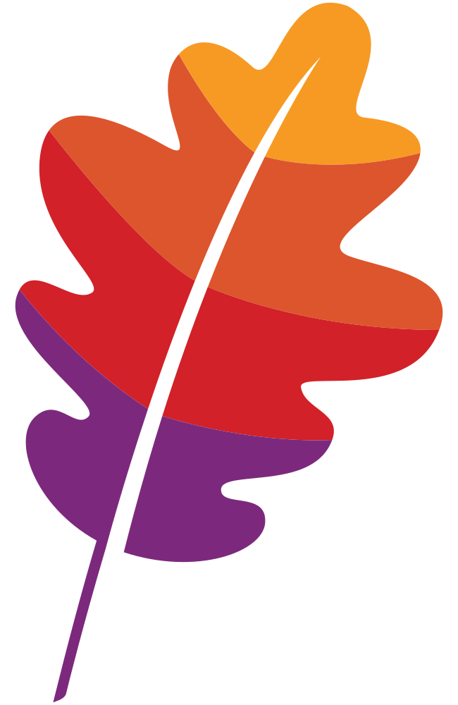

  

  
  
  

 

<table>
<tr>
<td width="65%" valign="top">

### <picture></picture> Hi, I'm QwQBiG

You can also call me **iqwqi**. Welcome to my little corner of the universe.

I enjoy building reliable systems and interfaces with a little personality — from the first idea to the last pixel.

**Full Stack · Rust · Kotlin · Creative Web**

  
  <strong><a href="https://github.com/apache/asyncband">Apache Asyncband</a></strong> &nbsp; <code>ing...</code> 
  Incubating · Async Rust, in good company.

</td>
<td width="35%" valign="top" align="center">
  <picture>
    
  </picture>
</td>
</tr>
</table>

 

### <picture></picture> My Stack

  <picture>
    <source media="(max-width: 600px)" srcset="https://raw.githubusercontent.com/QwQBiG/QwQBiG/main/assets/stack-orbit-refined-mobile.svg" />
    <source media="(max-width: 1100px)" srcset="https://raw.githubusercontent.com/QwQBiG/QwQBiG/main/assets/stack-orbit-refined-compact.svg" />
    
  </picture>

### <picture></picture> Language Mix

   
  Top 5 languages by repository · Public, non-fork repositories.

 

  
<picture></picture> A little GitHub activity

   
  

    
  

 

  Stay curious. Make something lovely. Thanks for stopping by.
    
  

