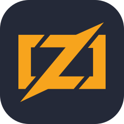
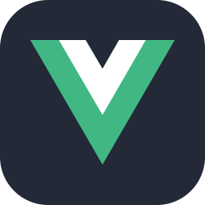
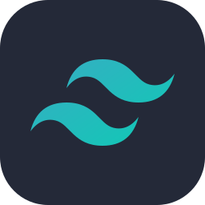
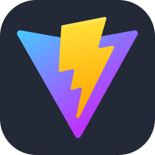
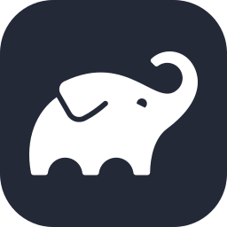
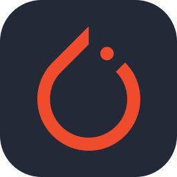
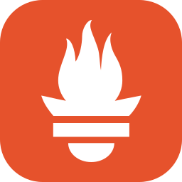

  

  
  
  

 

<table>
<tr>
<td width="65%" valign="top">

### <picture></picture> Hi, I'm QwQBiG

You can also call me **iqwqi**. Welcome to my little corner of the universe.

I enjoy building reliable systems and interfaces with a little personality — from the first idea to the last pixel.

**Full Stack · Rust · Kotlin · Creative Web**

  
  <strong><a href="https://github.com/apache/asyncband">Apache Asyncband</a></strong> &nbsp; <code>ing...</code> 
  Incubating · Async Rust, in good company.

</td>
<td width="35%" valign="top" align="center">
  <picture>
    
  </picture>
</td>
</tr>
</table>

 

### <picture></picture> My Stack

  LANGUAGES  
   &nbsp;
   &nbsp;
   &nbsp;
   &nbsp;
   &nbsp;
   &nbsp;
   &nbsp;
   &nbsp;
   &nbsp;
  
    
  Rust · Kotlin · Go · Zig · Python · TypeScript · JavaScript · C / C++ · Bash

  WEB &amp; CREATIVE CODING  
   &nbsp;
   &nbsp;
   &nbsp;
   &nbsp;
   &nbsp;
   &nbsp;
   &nbsp;
  
    
  Astro · React · Vue · Tailwind CSS · Vite · Three.js GSAP · Motion · Lenis · React Three Fiber · Canvas 2D · WebAssembly

  ANDROID  
   &nbsp;
   &nbsp;
  
    
  Jetpack Compose · Material 3 · Room · DataStore · Hilt · Kotlin Coroutines

  RUNTIMES &amp; BACKEND  
   &nbsp;
   &nbsp;
  
    
  Tokio · Gin · GORM · Node.js · pnpm · esbuild

  AI &amp; COMPUTER VISION  
   &nbsp;
   &nbsp;
  
    
  PyTorch · OpenCV · Ultralytics / YOLO · ONNX Runtime · Ollama

  INFRASTRUCTURE &amp; DATA  
   &nbsp;
   &nbsp;
   &nbsp;
   &nbsp;
   &nbsp;
   &nbsp;
   &nbsp;
   &nbsp;
  
    
  Docker Compose · Kubernetes · Helm · Argo CD · GitOps Prometheus · Grafana · PostgreSQL · SQLite · MySQL · Redis

### <picture></picture> Language Mix

   
  Top 5 languages by repository · Public, non-fork repositories.

 

  
<picture></picture> A little GitHub activity

   
  

    
  

 

  Stay curious. Make something lovely. Thanks for stopping by.
    
  

