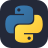

  

  <a href="https://iqwqi.win">My Website</a> &nbsp; / &nbsp;
  <a href="https://leetcode.cn/u/iqwqi/">LeetCode</a> &nbsp; / &nbsp;
  <a href="https://space.bilibili.com/3546921071282890">Bilibili</a>

 

<table>
<tr>
<td width="65%" valign="top">

### ☾ Hi, I'm QwQBiG

You can also call me **iqwqi**. Welcome to my little corner of the universe.

I enjoy building reliable systems and interfaces with a little personality — from the first idea to the last pixel.

**Full Stack · Rust · Kotlin · Creative Web**

  
  <strong><a href="https://github.com/apache/asyncband">Apache Asyncband</a></strong> &nbsp; <code>ing...</code> 
  Incubating · Async Rust, in good company.

</td>
<td width="35%" valign="top" align="center">
  
   
  Click her · Visit my world ↗
    
  

    
✦ Poke me

     
    
    
A little happiness, just for you.

  

</td>
</tr>
</table>

 

### ✧ Selected Work

<table>
<tr>
<td width="50%" valign="top">
  01 / MOBILE
  <h3><a href="https://github.com/QwQBiG/XianGeCe">XianGeCe &#8599;&#65038;</a></h3>
  
A local-first campus companion for schedules, tasks, notes, and everyday student life.

  
 &nbsp; 

</td>
<td width="50%" valign="top">
  02 / CREATIVE WEB
  <h3><a href="https://iqwqi.win">iqwqi.win &#8599;&#65038;</a></h3>
  
My personal corner of the web for writing, playful visuals, and things I build.

  
 &nbsp;  &nbsp;  &nbsp; 

</td>
</tr>
<tr>
<td width="50%" valign="top">
  03 / COMPUTER VISION
  <h3><a href="https://github.com/QwQBiG/bee_project">Bee Vision &#8599;&#65038;</a></h3>
  
Bee detection, tracking, and behavior reports for videos inside and outside the hive.

  
 &nbsp; 

</td>
<td width="50%" valign="top">
  04 / OPERATIONS
  <h3><a href="https://github.com/QwQBiG/qwq-ops">qwq-ops &#8599;&#65038;</a></h3>
  
A Kubernetes setup with observability, dashboards, and GitOps deployment workflows.

  
 &nbsp;  &nbsp;  &nbsp; 

</td>
</tr>
<tr>
<td width="50%" valign="top">
  05 / RUST NOTES
  <h3><a href="https://github.com/QwQBiG/Go-learn-Rust">Go-learn-Rust &#8599;&#65038;</a></h3>
  
Runnable Rust notes, from ownership and lifetimes to async futures and custom timers.

  

</td>
<td width="50%" valign="top">
  06 / EXPERIMENTS
  <h3><a href="https://github.com/QwQBiG/MyWork">MyWork &#8599;&#65038;</a></h3>
  
Coursework, experiments, and notes from my undergraduate projects.

  
 &nbsp;  &nbsp; 

</td>
</tr>
</table>

<a href="https://github.com/QwQBiG?tab=repositories">Explore all repositories ↗</a>

### ⌘ My Stack

  LANGUAGES  
   &nbsp;
   &nbsp;
   &nbsp;
   &nbsp;
   &nbsp;
  

  WEB &amp; MOBILE  
   &nbsp;
   &nbsp;
   &nbsp;
  

  TOOLS &amp; DATA  
   &nbsp;
   &nbsp;
   &nbsp;
   &nbsp;
   &nbsp;
   &nbsp;
  

### ◌ Language Mix

   
  Top 5 languages by repository · Public, non-fork repositories.

 

  
⌁ A little GitHub activity

   
  

    
  

 

  Stay curious. Make something lovely. Thanks for stopping by.
    
  

